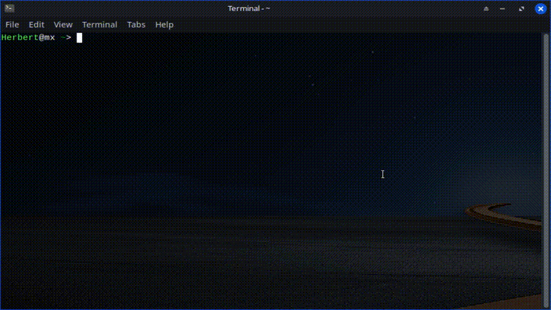

  

# 💰 Pivot
> A lightweight **CLI** financial management tool built for speed and efficiency.



## 🎯 Overview
I built Pivot as my final **CS50P** project, then kept going once it turned out to be genuinely useful. It is a **lightweight**, easy-to-set-up CLI for tracking income and expenses: no large application to install, just a terminal program that records what you spend and tells you your balance from anywhere.

### Key features
* **Instant logging:** add a transaction without leaving the terminal.
* **Data persistence:** everything is saved to a local CSV file.
* **Summary reports:** your running balance, calculated in real time.
* **Validation:** clear errors for bad dates and currency input.

## 🛠️ Technical Implementation
* **Language:** Python 3.10+
* **Storage:** CSV (Comma Separated Values)
* **Testing:** Pytest unit tests for the core logic (not needed to run the program)
* **Environment:** Optimized for **low-end devices**.

## 🌍 Running From Anywhere

### Install
```bash
pip install git+https://github.com/Herbertbuilds/Pivot.git
pivot
```

Or with [`pipx`](https://pipx.pypa.io/) - recommended for CLI tools, keeps
Pivot in its own isolated environment and puts the command on your PATH:

```bash
pipx install git+https://github.com/Herbertbuilds/Pivot.git
```

### Update
```bash
pipx install --force git+https://github.com/Herbertbuilds/Pivot.git
```
(For plain `pip` installs: `pip install -U git+https://...`.)

### Uninstall
```bash
pipx uninstall pivot-finance
```
Uninstalling never touches your data - the ledger stays put (see below).

### Run without installing
Pivot's ledger follows you everywhere, but if you'd rather run straight from
a clone than install, an alias works fine:

```fish
# Fish
alias Pivot="env PYTHONPATH=~/Code/Pivot/src python3 -m pivot"
funcsave Pivot
```
```bash
# Bash/Zsh - add to your .bashrc or .zshrc
alias pivot='cd /path/to/Pivot && PYTHONPATH=src python3 -m pivot'
```

### The Menu
```
[1] Add Transaction        log an income or expense with validation
[2] View Balance           the running total
[3] View All Transactions  every entry in an aligned table
[4] Monthly Summary        income/expense/net grouped by month
[5] Exit
```

### The Ledger Location
Pivot keeps its ledger at `~/.pivot/finance.csv` - the same file no matter
which directory you run it from, so your balance never resets just because
you `cd`'d somewhere else. Precedence:

1. `$PIVOT_DATA` environment variable
2. `~/.pivot/config` file - a line like `data = /path/to/your.csv`
3. the default `~/.pivot/finance.csv`

So to check which file is active, just look at those two: your
`$PIVOT_DATA` (unset in most shells) and `~/.pivot/config`.

### Project Structure
```
Pivot/
├── docs/              # README media (demo GIF)
├── src/pivot/         # the app (core logic + terminal interface)
└── tests/             # pytest suite
```
